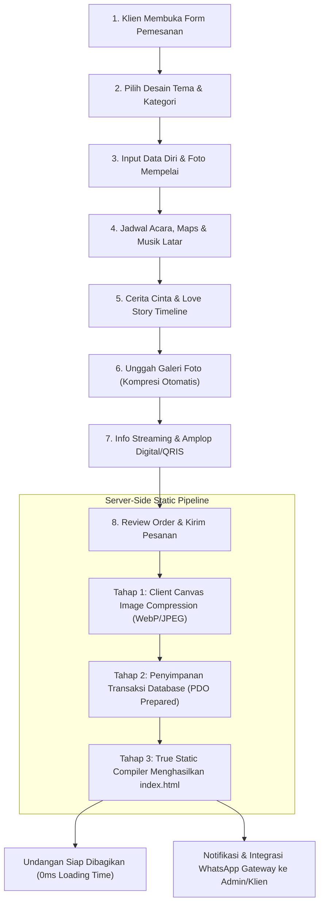

# Permata Wedding — Online Invitation & Order Management System

[](https://invitation-test.permatawedding.com/)
[-brightgreen?style=for-the-badge&logo=checkmarx&logoColor=white)](tests/run_all.php)
[](docs/MEMORY.md)

Sistem manajemen pemesanan dan generator undangan digital pernikahan modern (*True Static Pre-Rendering*) berbasis PHP, MySQL, Vanilla JavaScript, serta terintegrasi penuh dengan **WhatsApp Gateway Center** (GoWA).

🔗 **Live Preview Link:** [https://invitation-test.permatawedding.com/](https://invitation-test.permatawedding.com/)

---

## 🔄 Alur Pemesanan Klien (Client Order Workflow)

Proses pemesanan dirancang intuitif, cepat, dan sepenuhnya otomatis dari sisi klien (*front-facing customer*) hingga undangan siap dibagikan:



### Penjelasan Tahapan Alur Pemesanan:

1. **Langkah 1 — Pilih Tema & Desain (`Pilih Desain`)**:
   - Klien memilih tema yang diinginkan (tersedia tema Modern, Luxury, Zen, Javanese, Floral, dsb).
   - Dilengkapi pencarian instan dan filter kategori, serta tombol live demo pratinjau tema secara langsung.
2. **Langkah 2 — Data Mempelai (`Data Diri`)**:
   - Mengisi nama lengkap, nama panggilan, nama orang tua, serta media sosial kedua mempelai.
   - Mengunggah foto profil masing-masing mempelai dan foto sampul utama (*Hero Cover*).
3. **Langkah 3 — Acara & Musik Latar (`Waktu & Lagu`)**:
   - Mengatur detail Akad/Pemberkatan dan Resepsi (tanggal, jam mulai, opsi *"Sampai Selesai"*, nama gedung, dan tautan Google Maps).
   - Tombol cerdas *"Salin Lokasi dari Acara 1"* untuk menghemat waktu input lokasi resepsi.
   - Memilih lagu latar (*background music*) dari katalog CDN atau mengunggah audio MP3 sendiri.
4. **Langkah 4 — Cerita Cinta (`Love Story`)**:
   - Menambahkan tonggak perjalanan kisah cinta (Pertama Bertemu, Lamaran/Khitbah, Menuju Pelaminan) lengkap dengan tahun, deskripsi, dan foto dokumentasi momen.
5. **Langkah 5 — Galeri Foto Prewedding (`Foto Prewedding`)**:
   - Klien dapat mengunggah banyak foto sekaligus.
   - **Client-Side Compression**: Foto otomatis dikompresi di peramban klien via HTML5 Canvas (resolusi maks 1600px) sebelum dikirim, memangkas ukuran hingga 90% tanpa mengurangi ketajaman visual.
   - Dilengkapi tombol silang `(×)` pada masing-masing thumbnail untuk membatalkan atau mengganti foto.
6. **Langkah 6 — Live Streaming & Amplop Digital (`Streaming & Rekening`)**:
   - Opsi tautan siaran langsung (YouTube / Instagram / Zoom).
   - Slot rekening amplop digital (BCA, Mandiri, BRI, BNI, BSI, DANA, GoPay, OVO, ShopeePay) dengan auto-clean spasi nomor rekening, upload QRIS, dan alamat pengiriman kado fisik.
7. **Langkah 7 — Review Order & Submit**:
   - Meninjau seluruh ringkasan data pesanan, nomor WhatsApp aktif pemesan, dan catatan khusus.
   - **Auto-Save Draft**: Draf data klien tersimpan otomatis di LocalStorage peramban sehingga tidak akan hilang jika peramban tidak sengaja tertutup atau terefresh.
8. **Proses Kompilasi & Penyelesaian (Real-Time Modal)**:
   - Saat tombol submit ditekan, modal interaktif menampilkan progres 3 tahap secara real-time:
     1. Unggah & sinkronisasi media foto.
     2. Penyimpanan data relasional ke database MySQL.
     3. *Pre-rendering static compiler* membangun website statis mandiri di `/{year}/{slug}/index.html`.
   - Klien langsung menerima link undangan aktif yang siap disebarkan ke para tamu undangan.

---

## 🌟 Fitur Utama

### 1. 💌 True Static Pre-Rendering (0ms FCP / LCP)
* **High Performance**: Halaman undangan pernikahan dikompilasi langsung menjadi HTML statis murni di direktori `/{year}/{slug}/index.html` tanpa injeksi data berat di sisi klien.
* **OpenGraph Absolut untuk Medsos**: Dukungan penuh crawler WhatsApp, Telegram, dan Facebook dengan resolusi otomatis URL gambar sampul absolut (`og:image`, `og:url`, `twitter:image`).
* **Lightweight View Tracker**: Pencatatan statistik jumlah kunjungan undangan non-blocking melalui `navigator.sendBeacon` dengan proteksi `sessionStorage` (anti-double-count).
* **Blueprint Cloning**: Perbanyakan kartu cerita cinta (*Love Story*) dan slot amplop digital secara dinamis tanpa batasan.

### 2. 📝 Formulir Pemesanan Klien Modern (Client-Side Experience)
* **Modular Architecture**: Kode terpisah rapi di [assets/css/order.css](file:///c:/xampp/htdocs/order-permata/assets/css/order.css) dan modul JavaScript modular di [assets/js/](file:///c:/xampp/htdocs/order-permata/assets/js/).
* **Client-Side Canvas Compression**: Kompresi otomatis gambar mempelai & galeri di browser (resolusi maks 1600px, WebP/JPEG) menyusutkan ukuran file hingga ~90% sebelum diunggah ke server.
* **Manajemen Galeri Interaktif**: Tombol silang `(×)` individual untuk membatalkan/menghapus pilihan foto sebelum submit.
* **Stepper Bebas Loncat**: Navigasi multi-step 1–7 dengan indikator langkah yang dapat diklik langsung kapan saja.
* **Auto-Save Draft**: Draf formulir otomatis tersimpan di LocalStorage dengan banner pemulihan draf.

### 3. ⚙️ Admin Panel & Detail Order
* **One-Click Recompile**: Tombol generator untuk mengompilasi ulang website undangan langsung dari database jika terjadi perubahan data atau tema.
* **Live Preview Responsif**: Modal preview undangan dengan tombol switch mode layar **Desktop** dan **Mobile (375px)**.
* **Rekap RSVP & Tamu**:
  * Ringkasan kehadiran (Hadir Pasti, Berhalangan, Masih Ragu, Total Tamu).
  * **Ekspor CSV**: Mengunduh seluruh daftar konfirmasi kehadiran ke file spreadsheet Excel/CSV (UTF-8 BOM).
  * **Salin Rekap WA**: Format teks ringkasan RSVP instan untuk dikirim langsung ke WhatsApp pengantin.
* **Pusat Media & CDN Musik**: Pemutar musik dan pemilihan lagu latar belakang undangan.

### 4. 💬 WhatsApp Gateway Center (GoWA Integration)
* **Live Chat Inbox (Two-Way Conversation)**: Tampilan chat 2 arah mirip WhatsApp Web untuk membalas pesan klien secara langsung (`Ctrl + Enter`).
* **Sinkronisasi Pesan Server**: Terintegrasi langsung dengan API endpoint GoWA (`/chat/{jid}/messages`) dan log lokal SQLite.
* **Device Status & Monitoring**: Status real-time perangkat (*Connected*, *QR Code needed*, *Disconnected*).
* **Reconnect & QR Scanner**: Tombol *Reconnect* session dan modal *Scan QR Code* langsung di antarmuka admin.

---

## 📂 Struktur Direktori

```text
order-permata/
├── admin/                  # Dashboard & Panel Admin
│   ├── assets/             # CSS & JS Admin (app.js, style.css)
│   ├── cdn/                # Layanan Media & Audio Hub
│   ├── wa/                 # WhatsApp Gateway Service & Storage SQLite
│   └── index.html          # Halaman Utama Dashboard Admin
├── api/                    # RESTful Backend API (PHP + PDO)
│   ├── config/             # Konfigurasi Database & Keamanan
│   ├── controllers/        # Controller (Order, Couple, Event, Comment, dll)
│   ├── core/               # True Static Compiler (InvitationCompiler.php)
│   └── index.php           # Entry Point API & Router
├── assets/                 # Aset Publik Formulir Pemesanan
│   ├── css/order.css       # Stylesheet Form Pemesanan
│   ├── js/                 # Modular JS (order-stepper, order-upload, dll)
│   └── fonts/              # Webfonts Material Symbols
├── cdn/                    # Direktori Media Audio (MP3) & Preset Musik
├── docs/                   # Dokumentasi Pengembangan & Memori Proyek
│   ├── MEMORY.md           # Catatan Arsitektur & Log Perubahan
│   ├── PROGRESS.md         # Status dan Tracker Progres Fitur
│   └── SCHEMA.md           # Struktur Skema Database
├── templates/              # Master Template Undangan Pernikahan
│   ├── fresh-minimal/
│   ├── midnight-luxury/
│   ├── pink-elegance/
│   ├── premium-elegant-javanese/
│   ├── premium-eternal-luxe/
│   ├── premium-ivory-grace/
│   ├── royal-premium/
│   └── sakura-zen/
├── tests/                  # Automated Unit Test Suite (110 Tests)
├── uploads/                # Direktori Unggahan Media (Dilindungi .htaccess anti-RCE)
├── index.html              # Halaman Formulir Pemesanan Klien
└── invitation_permatawedding.sql # Skema Database Awal MySQL
```

---

## 🚀 Panduan Instalasi Lokal

### 1. Kebutuhan Sistem
* **Web Server**: Apache / Nginx (XAMPP / Laragon).
* **PHP**: Versi 8.1 atau lebih tinggi (ekstensi `pdo_mysql`, `curl`, `mbstring`, `fileinfo`, `gd`/`imagick` aktif).
* **Database**: MySQL / MariaDB versi 5.7+ atau 8.0+.

### 2. Setup Database
1. Buka phpMyAdmin atau MySQL CLI.
2. Buat database baru bernama `order_permata`:
   ```sql
   CREATE DATABASE order_permata CHARACTER SET utf8mb4 COLLATE utf8mb4_unicode_ci;
   ```
3. Import file `invitation_permatawedding.sql` ke dalam database tersebut.
4. Sesuaikan konfigurasi koneksi database di [api/config/database.php](file:///c:/xampp/htdocs/order-permata/api/config/database.php) jika diperlukan:
   ```php
   define('DB_HOST', 'localhost');
   define('DB_NAME', 'order_permata');
   define('DB_USER', 'root');
   define('DB_PASS', '');
   ```

### 3. Akses Aplikasi
* **Formulir Pemesanan Klien**: `http://localhost/order-permata/`
* **Admin Panel**: `http://localhost/order-permata/admin/`
* **Endpoint API**: `http://localhost/order-permata/api/`

---

## 🧪 Pengecekan Sistem (Automated Tests)

Proyek ini sudah dilengkapi pengujian otomatis untuk memastikan semua tema dan logika pembuatan undangan berjalan 100% normal. Untuk menjalankannya, buka terminal dan ketik:

```bash
php tests/run_all.php
```

Semua pengujian (110 tests) harus berada dalam status **100% PASS**:
1. **Test Suite 1**: Validasi kepatuhan 8 tema terhadap kontrak HTML & standar modern web.
2. **Test Suite 2**: Validasi True Static Pre-Rendering, sinkronisasi media, OpenGraph absolut, dan View Tracker.
3. **Test Suite 3**: Validasi keamanan Cloudflare Security, sanitasi XSS (`htmlspecialchars`), proteksi Path Traversal, dan pencegahan RCE di folder uploads.

---

## 🛡️ Standar Keamanan
* **SQL Injection**: Seluruh query database wajib menggunakan PDO Prepared Statements dengan parameter binding.
* **Anti-RCE**: Direktori `uploads/` dilindungi oleh `.htaccess` yang mematikan parser PHP engine dan mencabut hak eksekusi script.
* **XSS Sanitization**: Seluruh input teks di-escape sebelum disimpan dan dikompilasi ke file HTML.
* **API Route Protection**: Seluruh endpoint mutasi (`POST`, `PUT`, `DELETE`) dilindungi oleh Bearer Token Admin.

---

## 📄 Lisensi
Hak Cipta © 2026 **Permata Wedding**. Seluruh hak cipta dilindungi undang-undang.
