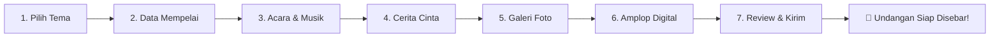

# 💍 Permata Wedding — Sistem Pemesanan & Undangan Digital

Selamat datang di repositori **Permata Wedding**! Proyek ini adalah platform pemesanan dan pembuat (*generator*) undangan pernikahan digital yang dirancang agar undangan terbuka **instan tanpa loading lama** saat diakses para tamu dari WhatsApp atau media sosial.

🔗 **Coba Live Preview:** [https://invitation-test.permatawedding.com/](https://invitation-test.permatawedding.com/)

---

## ✨ Kenapa Dibuat Seperti Ini?

Banyak undangan web terasa berat dan lambat saat dibuka di smartphone karena harus memuat database dan JavaScript yang rumit setiap kali ada tamu yang berkunjung. 

Di Permata Wedding, kami menggunakan pendekatan **True Static Pre-Rendering**:
- Ketika pesanan selesai dibuat, sistem otomatis menyusun halaman `index.html` statis yang bersih dan mandiri untuk pasangan tersebut di folder `/{tahun}/{slug}/`.
- **Hasilnya:** Halaman langsung terbuka seketika (*0ms delay*), hemat kuota tamu, dan foto pengantin di preview WhatsApp/Telegram selalu muncul rapi.

---

## 🧭 Alur Pemesanan Calon Pengantin

Proses dari awal klien memesan hingga undangan siap dibagikan dibuat sangat simpel dan nyaman, bahkan saat diisi lewat layar ponsel:



1. **Pilih Tema Favorit**  
   Klien memilih desain yang cocok (minimalis, elegan, adat jawa, floral, dll.) lengkap dengan tombol live demo untuk mencoba tampilan aslinya.
2. **Isi Data Kedua Mempelai**  
   Masukkan nama calon pengantin, nama orang tua, akun media sosial, serta foto profil dan foto sampul utama (*cover*).
3. **Atur Acara & Musik Pengiring**  
   Tentukan tanggal dan jam akad/resepsi, sematkan link Google Maps lokasi gedung, serta pilih lagu latar favorit dari katalog musik kami (atau upload lagu sendiri). Tersedia tombol cepat *"Salin Lokasi dari Acara 1"* agar tidak perlu mengetik ulang alamat yang sama.
4. **Tulis Kisah Cinta (Love Story)**  
   Pasangan bisa membagikan momen perjalanan cinta mereka (awal bertemu, lamaran, hingga hari pernikahan) lengkap dengan tahun dan foto kenangan.
5. **Unggah Galeri Foto Prewedding**  
   Bebas upload banyak foto prewedding sekaligus. Foto otomatis diperkecil ukurannya langsung di browser tanpa mengurangi ketajaman, sehingga proses upload tetap ngebut meski menggunakan koneksi internet ponsel.
6. **Live Streaming & Amplop Digital**  
   Sematkan tautan siaran langsung (YouTube/Instagram) dan nomor rekening bank / dompet digital / barcode QRIS untuk memudahkan tamu yang ingin mengirim kado pernikahan.
7. **Review & Kirim Pesanan**  
   Klien memeriksa kembali seluruh ringkasan data, lalu klik tombol kirim. Sistem akan memproses dan langsung menerbitkan link undangan yang siap disebarkan ke para tamu.

> 💡 **Fitur Penyelamat Draf:** Jika browser tidak sengaja tertutup atau baterai habis saat mengisi data, formulir otomatis menyimpan draf terakhir di peramban, jadi klien tidak perlu mengisi dari awal lagi.

---

## 🎯 Fitur-Fitur Andalan

- **Undangan Super Ringan & Cepat:** Setiap undangan berwujud HTML statis murni sehingga tidak membebani server saat diserbu ratusan tamu sekaligus.
- **Thumbnail WhatsApp Otomatis:** Foto kedua mempelai otomatis tampil cantik dan proporsional saat tautan undangan dibagikan di grup atau pesan pribadi WhatsApp.
- **Kompresi Gambar Otomatis:** Mengurangi ukuran foto hingga 90% langsung di browser pengguna sebelum dikirim ke server.
- **Admin Panel & WhatsApp Gateway:** Pemilik website dapat mengelola pesanan, melihat statistik kunjungan, merekap konfirmasi kehadiran tamu (RSVP) ke format Excel/WhatsApp, serta membalas pesan klien langsung dari dashboard.
- **Keamanan Data Terjaga:** Bebas dari celah SQL Injection dengan PDO Prepared Statements, serta folder upload foto yang terlindungi dari eksekusi file berbahaya.

---

## 🛠️ Cara Menjalankan di Komputer Lokal

Jika teman atau rekan Anda ingin ikut mencoba atau mengembangkan proyek ini di laptop/PC:

### 1. Persiapan
Pastikan sudah terpasang **XAMPP** atau **Laragon** dengan:
- PHP versi 8.1 ke atas.
- MySQL / MariaDB.

### 2. Pasang Database
1. Buka **phpMyAdmin** (`http://localhost/phpmyadmin`).
2. Buat database baru bernama `order_permata`.
3. Import file [invitation_permatawedding.sql](file:///c:/xampp/htdocs/order-permata/invitation_permatawedding.sql) ke database tersebut.
4. Jika username/password database lokal Anda berbeda, sesuaikan pengaturannya di file [api/config/database.php](file:///c:/xampp/htdocs/order-permata/api/config/database.php).

### 3. Akses Melalui Browser
- **Formulir Pemesanan Klien:** `http://localhost/order-permata/`
- **Dashboard Admin:** `http://localhost/order-permata/admin/`
- **Link Demo Online:** [https://invitation-test.permatawedding.com/](https://invitation-test.permatawedding.com/)

---

## 🧪 Pengecekan Sistem (Automated Tests)

Proyek ini sudah dilengkapi pengujian otomatis untuk memastikan semua tema dan logika pembuatan undangan berjalan 100% normal. Untuk menjalankannya, buka terminal dan ketik:

```bash
php tests/run_all.php
```

Semua 110 pengujian (validasi tema, fungsi compiler, keamanan XSS, dan perlindungan folder) akan dicek secara otomatis.

---

## 📂 Gambaran Struktur Folder

```text
order-permata/
├── admin/          # Dashboard admin, rekap RSVP & WhatsApp chat
├── api/            # Logika backend API & pembuatan undangan statis
├── assets/         # Desain CSS, modul JavaScript, dan font formulir pemesanan
├── cdn/            # Koleksi lagu latar (file audio MP3)
├── docs/           # Catatan arsitektur & progres fitur
├── templates/      # Master tema desain undangan pernikahan
├── tests/          # Skrip pengujian otomatis (110 tests)
├── uploads/        # Folder aman untuk foto mempelai & galeri
└── index.html      # Halaman utama formulir pemesanan klien
```

---

Dibuat dengan dedikasi untuk menghadirkan pengalaman terbaik bagi calon pengantin dan tamu undangan.
